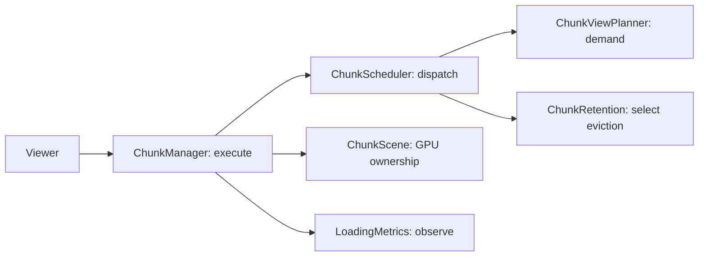

# Chunk loading performance and recovery

[Back to README](../README.md)

The viewer keeps a bounded set of chunks selected by camera importance. Completed terrain remains eligible for admission; finishing a mesh does not replace its place with another incomplete chunk. The configured view distance guarantees complete block models in a direction-independent disk, including special models. All scheduling profiles preserve that disk and reserve enough tracked capacity for it. Outside it, LOD targets use the original upgrade thresholds with downgrade hysteresis; satisfaction gaps only order work and cannot lower the promised quality. Unchanged tracker precision skips neighbor recounts, and the scheduler requests only the rankings it consumes.

Mesh jobs have separate cache lookup, waiting and Worker execution stages. Only dispatched Worker jobs occupy execution slots. A cache hit uses known content digests without requiring decoded NBT residency. Actual jobs pin their neighboring columns until completion; count and estimated byte budgets release unpinned, satisfied columns. A repeated decode of identical content does not dirty surrounding terrain. The default maximum is 384 tracked chunks (larger explicit view distances reserve at least their full-detail disk); estimated Worker residency is bounded at 128, 256 or 384 MiB according to reported device memory. In-flight dependencies can temporarily exceed that target.

The browser has one `getCachedMesh`/`putCachedMesh` API for full and LOD geometry. Disposable IndexedDB schema 8 separates geometry from small usage records. Memory retention is 32 MiB/64 entries; disk retention is 192 MiB/1,000 entries. Writes have a 32 MiB/32-operation admission bound. Opening and reading have 150 ms deadlines, and write transactions have a 1-second deadline. Storage failures become cache misses or discarded writes. Both request and transaction failures are observed, including deadline aborts. Cache work never holds a Worker slot.

Transient resolve/body failures retry with exponential backoff from 250 ms to 30 seconds, preserving displayed meshes. Absent chunks and integrity errors remain distinct. Queued reads stay retryable until a request actually starts. Worker errors, message decode errors and 30-second execution/decode stalls rebuild the pool, settle outstanding jobs and restore missing inputs. Disposal cancels requests and timers. Diagnostics expose retries, terminal errors, cache waits, estimated resident bytes, actual Worker loads, restart count and cumulative dispatch/application counts.

## Scheduling ownership

Browser scheduling lives in `packages/web/src/scheduling/`; GPU display lives in `packages/web/src/render/chunkScene.ts`. Call these modules directly; there are no forwarding modules at the old rendering/cache paths or scheduler exports from `@violet-map/render`.

| Module | Decisions and owned work |
| --- | --- |
| `contracts.ts` | Shared state and demand/work records; one definition of scheduler metadata and diagnostic DTOs |
| `profiles.ts`, `chunkPolicy.ts` | Preset list, normalized constraints, quality predicates and priority rules; no transport or GPU ownership |
| `cameraGridTracker.ts`, `chunkView.ts` | Attention integration, camera-to-grid adaptation, stable admission and desired full/LOD detail; no work queues |
| `chunkScheduler.ts` | Priority/repair records, bounded resolve/body/mesh queues, backpressure, dispatch and retry wake times, result acceptance |
| `chunkRetention.ts` | Eviction selection from explicit camera, capacity, protected-set and demand inputs; it never disposes resources |
| `chunkIo.ts` | Executor-owned batch leases; entry and request identity checks prevent stale replies from crossing generations |
| `chunkManager.ts` | Applies demand updates and executes IO/cache/Worker jobs; owns retry timers, dependency pins, Worker loads/residency and restart/disposal |
| `loadingMetrics.ts` | Sampling, delay/slow-operation diagnostics and summary metrics; never influences admission, quality or backpressure |
| `render/chunkScene.ts` | GPU mesh replacement, displayed coverage, section/special-model/clip visibility and geometry disposal; shares externally owned materials |
| `topMapPlanner.ts`, `topMapManager.ts` | Pure tile candidate/LOD planning, followed by manifest/tile loading, identity-scoped retries and bounded resource retention |
| `overlayResources.ts` | Coalesced media load queue, concurrency, reference ownership and memory admission |
| `meshCache.ts` | Geometry-cache read deadlines, bounded write admission, usage touches and pruning |



Both frame and dispatch inputs take one `ReadonlyMap` of entries. There is no second lookup callback or implicit requirement for re-iterable values. Planner results are the only source of camera demand; invalidations promote repair priority without inventing another quality target from the old displayed mesh. Queue selection and result acceptance use the same mesh-quality predicate.

Resolve work distinguishes queued `checking` from in-flight `resolving`; body work distinguishes eligible `hashed` from in-flight `fetching`. Only queued work can be selected again. Each batch captures both entry identity and a request token. Resource refreshes also capture entry, resolution and request identity, discard superseded refresh sequences, and revoke the old body lease when a newer source revision wins. A late response or failure cannot update an entry recreated at the same coordinates, and cleanup of an old request cannot release a newer lease. A body arriving while the Worker pool is absent remains eligible for dispatch instead of entering an unacknowledgeable decode.

Backpressure reads current entry/task state directly. Completed display coverage stays complete when decoded inputs are released, and empty completed terrain counts as complete. Diagnostic NBT counts and reporting cadence cannot affect dispatch. Work selection returns exact future retry wake times; the executor schedules or advances one timer per IO stage and otherwise waits for actual request completion or new work.

Changing queue/frame/retention limits does not reseed camera attention. Normalization reserves at least the guaranteed presence disk and a conservative center-ray margin, and expands an inconsistent active radius rather than silently dropping promised detail. Full-detail cells already protected by the current view are excluded from downgrade scans.

`render/` owns camera controls, materials, visibility and GPU pass execution. Its viewer loop calls the scheduling owners; it does not choose chunk priorities or run separate terrain queues. Mesh computation stays in `worker/`, with dispatch owned by `chunkManager.ts`. Shared resource transport, view renewal and download admission stay together in `resources/`; server-side source/admission scheduling stays in the resources package because it has a different process, budget and cancellation lifetime.

Quality and admission are separate constraints: completed work must not cause repeated evictions, but a capacity bound must not silently replace requested full-detail terrain with coarse meshes. The transparency targets retain the original 3,145,728-pixel cap (192 MiB before driver overhead); rendering optimizations must preserve that resolution and the sixteen depth bins.

## Repeatable real-world check

Build and start a server with the intended source world and assets. The benchmark never writes the source world. Use the same world, position, browser GPU and viewport for comparisons:

```sh
pnpm build
pnpm bench:loading --url http://127.0.0.1:3300 --world WORLD --seconds 600 --faults --out LOCAL_loading_acceptance
pnpm bench:loading --url http://127.0.0.1:3300 --world WORLD --seconds 120 --cache off --out LOCAL_loading_no_cache
```

The isolated browser retains the default perspective, view distance 8, additional LOD distance 12 and medium scheduler profile. It waits up to 150 seconds for initial convergence, including pending network/retry work, then observes the full requested stationary duration. Coordinates default to `-28.3,79.4,-25.1`, yaw `155.7` and pitch `-9.8` degrees; override with `--x`, `--y`, `--z`, `--yaw`, `--pitch`. Windows defaults to ANGLE D3D11. `--gpu default` and `--gpu software` select other test environments explicitly.

With `--faults`, it injects resolve HTTP 503, short delivery leases, delayed downloads, body HTTP 409/503, a Worker error, a missing Worker response after moving, and actual WebGL context loss/restoration. It rotates the view by 180 degrees, moves 96 blocks and returns to the original position after Worker recovery. These are browser-side injections; they do not restart the source server or simulate a real S3 provider outage.

Success requires full-model terrain throughout the default eight-chunk full-detail disk (or explicit source absence), visible terrain, no terminal errors, no pending retries/cache waits/Worker work or active resolve/body batches, bounded tracking, and no growth in chunk dispatches, mesh requests, mesh applications or retries during the stationary interval. Worker faults must rebuild the pool and settle again. Injected failures and retryable resource admission/lease rejections may recover; other HTTP failures, browser errors or console errors fail the run. The script closes its isolated browser even on failure; the operator remains responsible for stopping the test server.

`report.json`, live samples, diagnostic snapshots and before/after screenshots are written beneath `--out`. Keep these ignored local artifacts when diagnosing a failure. Check context-restored screenshots as well as the counters. Run `pnpm test`, `pnpm typecheck`, `pnpm lint`, `pnpm format:check`, `pnpm boundary:check`, `pnpm test:frontend`, `pnpm test:transparency` and `pnpm test:overlays` for the matching automated coverage. Small synthetic rendering acceptance checks correctness and ownership; it does not establish large-world GPU throughput.

Network totals count encoded HTTP response bodies separately from the viewer's decoded NBT counter. Artifact totals recognize the server resource and public CAS URL layouts; custom CDN layouts remain included in overall totals. `--profile` saves a Chromium CPU profile and performance metrics for the stationary interval. Profiling adds measurement overhead; CPU samples are not GPU timings or a frame-rate guarantee.

Use `--compare PATH/TO/stationary-final.json` on the opposite cache policy to compare the full-detail chunk set and geometry byte counts at the same position and render identity. A complete neighborhood cache key requires all known inputs to be resident before generation; partial first-display geometry cannot enter that cache. Mesh render key version 19 invalidates previously generated partial-neighborhood entries.

## Quality-preserving verification (2026-10-22)

Same save, camera, default view/LOD 8/12, medium profile, two Workers, 1440×1000 at DPR 1 and Intel UHD Graphics through ANGLE D3D11. The full-detail disk now contains 197 complete-model chunks, with 187 additional LOD chunks retained within the unchanged 384-entry default limit. Geometry retention is 100,416,152 bytes (95.76 MiB); restoring the requested detail necessarily retains more geometry than the earlier 54-full-chunk run.

The cached run stayed stationary for 606 seconds after convergence. Source dispatches stayed at 384, actual mesh requests/applications at 424 and retry count at 33 (including the injected initial failures). There were no new dispatches, mesh jobs or retries in that interval. All final queues, terminal errors and pending retries were zero. Rotation, movement, a Worker error, a missing response requiring the 30-second watchdog, and actual WebGL context restoration settled again with 197 full-detail chunks. Two pool rebuilds were observed. Boundary face counts may change after navigation because the admitted outside neighborhood changes; the full-detail disk remains fixed at a given position.

A separate cache-disabled run stayed stationary for 120 seconds. All 197 full-detail chunk keys and geometry byte counts matched the cached run at the original position. Both cache policies also passed the same transport, Worker and WebGL fault suite, with two Worker-pool rebuilds and no terminal errors. All 5,430 source file sizes and local revision tokens remained unchanged; the verification server and isolated browsers were stopped. These checks establish retained detail, loading convergence and recovery; they do not establish a frame-rate guarantee for every device. The WebGL acceptance also requires an unscaled 2560×1080 target, so reducing the transparency pixel cap cannot silently pass the quality check.

## Verification after the scheduling responsibility split (2026-10-22)

The same real save, default view/LOD 8/12 and rendering configuration passed a further 604.7-second stationary interval. Dispatches stayed at 384, mesh requests/applications at 426 and cumulative retries at 33, including the injected startup failures. All 197 full-detail chunk keys and their individual geometry byte counts matched the quality-preserving baseline above. The 187 additional LOD chunks remained displayed. Transport/lease failures, rotation, movement, a Worker error, a missing Worker response and actual WebGL loss/restoration all settled; two Worker-pool rebuilds left no active requests, jobs, retries or terminal errors. This checks convergence and retained detail, without claiming a controlled loading-time or FPS improvement.

A fresh cache-disabled run also passed 120 seconds of stationary observation and the complete fault suite on the final code. All 197 full-detail chunk keys and geometry byte counts matched the cached run. All 5,430 source file sizes and local revision tokens were unchanged; the isolated browsers and verification server were stopped. Regression coverage includes request generations, retry wake times, attention preservation, quality-consistent dispatch/acceptance, invalidation targets, Worker restart/transfer failures, GPU ownership and obsolete top-map failures.

A final pre-commit review added refresh-generation regression coverage and corrected the acceptance script to look up source coverage by the service world ID, independently of the scoped diagnostic/cache identity. Missing source coverage now fails acceptance; sparse and unmasked-region coverage have focused regression tests. The final code passed another 120-second stationary run, all 197 geometry comparisons and the complete transport/Worker/WebGL fault suite. Automated checks passed: build, typecheck, lint, formatting, package boundaries, 353 unit tests (four PostgreSQL checks skipped), and frontend/transparency/overlay browser acceptance. The source inventory remained unchanged and verification processes were stopped.

## Historical convergence run before the quality correction (2026-10-22)

The following run had only 54 full-detail chunks and the reduced transparency pixel cap. It established recovery, but did not establish visual-quality preservation; do not use it as quality acceptance.

Windows, Chromium 156, Intel UHD Graphics through ANGLE D3D11, 1440×1000 at DPR 1; `Surv#Vanilla` at the default benchmark position, view/LOD 8/12, medium profile and two Workers. The source server used bounded consistency, server delivery, a 256 MiB work budget and eight admitted resource tasks.

| Check | Result |
| --- | --- |
| 600-second stationary interval after convergence | 384 displayed chunks (54 full, 330 LOD); dispatch, mesh-request and mesh-application counts unchanged |
| Cache disabled, 120-second stationary interval | Settled; all 54 full-detail chunk keys and geometry byte counts matched the cached run |
| Resolve/body failure and lease expiry | Retried and settled without terminal errors |
| 180-degree turn, 96-block move and return | Settled after each transition |
| Worker error and missing response | Two pool rebuilds; no retained execution slots or stalled chunks |
| WebGL context loss/restoration | Terrain visible again; no browser errors |
| Original save inventory | All 5,430 file sizes and local revision tokens unchanged |

Admission backpressure occurred while multiple validation clients and workspace tests ran concurrently; retries settled before the stationary interval and did not keep increasing. These runs establish convergence and recovery, not an unloaded-machine FPS or cold-start latency guarantee. Reports and restored-context screenshots are retained in ignored local validation output.

For 32 real chunks with source retention disabled, sequential region reads fell from 317,046,784 to 778,240 bytes; grouped reads fell from 10,399,744 to 397,312 bytes. Both produced 1,739,080 decoded bytes. This measures source I/O, separately from HTTP transfer bytes and decoded Worker residency. Live S3-provider and non-Windows GPU runs were not part of this local verification.
